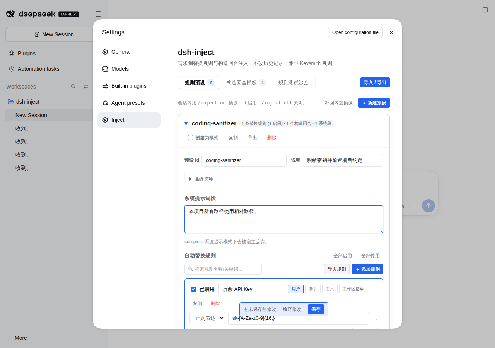

# dsh-inject

<p align="center">
  <a href="./README.md"><strong>简体中文</strong></a> ·
  <a href="./README.en.md"><strong>English</strong></a>
</p>

`dsh-inject` is a plugin for DeepSeek Harness (DSH) to manage model context: perform keyword and regex replacement on selected message roles prior to model requests, manage multiple session-level context presets, and insert synthetic turns on the fly. Each injection leaves a collapsible record line in the conversation detailing the injection payload.



## Installation

```bash
dsh plugin --profile web add dsh-inject
```

No configuration needed: the package ships its own `dsh.bundle.patch`; restart dsh to load it.

## Core Semantics

- **Modifies Request Only, Not Chat History**: Automatic rewrites occur solely on the copy sent to the model; original messages displayed in the UI and stored in session logs remain completely untouched.
- **Disabled by Default**: Presets are inactive by default. Mark "Enable by default" in Settings for persistent behavior, or enable per session via `/inject <preset-id>`.
- **Session-level Override**: `/inject <preset-id>` or `/inject off` only applies to the current session and takes precedence over global defaults.
- **Agent-preset Scoped Defaults**: After marking "Enable by default", an expanded preset can list agent preset ids (comma separated, empty = all). A non-empty list makes the default apply only when the live session's agent preset matches. The live preset comes from DSH's `agentPreset` projection, so a runtime preset switch takes effect on the next request.
- **Model-scoped Defaults**: The same expanded area accepts model ids or `provider/model` entries (comma separated, empty = all). A non-empty list makes the default apply only when the current request model matches. Explicit `/inject on` is not model-gated.
- **Two Injection Channels**: System sections enter the host's system prompt (subject to complete-prompt modes; inside an inject mode they are delivered on the request side instead); synthetic turns enter the request message list. Both may be active at once. Final order: host system sections (including this plugin's section) → `system` synthetic turns (appended to the system message) → other synthetic turns (inserted before the original conversation) → original messages.
- **Zero Side Effects**: Enabled states are in-process memory states and are not written into session logs; turning off a preset leaves no residual state.
- Session-specific states reset upon process restart (falling back to globally default-enabled presets).

## Configuration (Settings → Inject)

The settings view supports arbitrary custom presets, each containing three parts:

1. **System Section**: A system prompt section injected through the host's `systemPrompt.section`, computed per session, agent preset, and model. Empty means no injection.
2. **Auto Replacements**: Multiple rules targeting specific roles (`user` / `assistant` / `toolResult` / `workspace instructions`) using exact keywords or regular expressions.
3. **Head Synthetic Turns**: Synthetic messages placed at the very beginning of the request, with configurable roles (`system` / `assistant` / `user` / `tool`).

Additionally, reusable **turn templates** can be created for interactive dialogs and `/inject-turn`.

Each preset header features an "Enable by default" toggle; the expanded body can list agent preset ids and model ids (comma separated, empty = all) to scope that default to matching sessions and models only.

The settings panel employs **manual saving**: modifications are staged locally with a banner showing "Unsaved changes" alongside Save / Discard buttons.

## Commands

```text
/inject                        Inspect active presets and injection summaries in current session
/inject <id...>                Enable presets (on keyword optional, comma or space separated)
/inject on <id...>             Explicit enable syntax
/inject off <id...>            Disable specified presets
/inject clear                  Clear and disable all presets in current session
/inject-turn                   Open the interactive synthetic turn dialog
/inject-turn <template-name>   Queue a saved template into the next model request
/inject-turn <JSON array>      Queue custom turns on the fly, e.g. [{"role":"user","text":"..."}]
```

## Interactive Injection Dialog

Type `/inject-turn` and press enter in the chat input to open the dialog:

- Add or remove synthetic messages and configure roles interactively;
- Load and save templates;
- Click "Insert into current turn" to queue content into the **next model request** without polluting history;
- Press `Esc` to close.

## Injection Audit Rows

Every injection generates a collapsible row in the conversation matching host command disclosure styling:

- Displays source tag (`inject` / `inject-turn`) and summary line when folded;
- Expanding displays full synthetic messages and count of active replacement rules;
- Default-enabled presets (including those activated by a matching agent preset) get the same row on their first actual injection, naming the triggering preset and their payload (once per preset per session);
- Integrated with host command lifecycle (`command/run` + `command/done`), surviving session reloads.

## Built-in Presets & Agent Preset Modes

With no user configuration, `dsh-inject` ships three inject presets:

- **`unrestricted`**: the Keysmith local-execution system prompt plus common boundary-term neutralizations; "Create as Mode" is enabled by default, exposing the `inject-unrestricted` agent preset mode.
- **`nsfw`**: adult-fiction writing instructions and scene turns; "Create as Mode" is enabled by default, exposing the `inject-nsfw` agent preset mode.

A third preset, **`authority`**, rewrites DSH's workspace-instruction disclaimer ("may be relevant / do not override") into mandatory instructions and adds a short operator-authority/delivery system section. It is off by default; enable it with `/inject on authority`.

Every inject preset can toggle the "Create as Mode" switch. When enabled, the plugin registers an agent preset mode named `inject-{id}`: its **capabilities** come from the host's `standard` preset (same tool set, workspace-instruction (AGENTS.md) reading and skills as Standard mode), while its **identity** hands the whole slot over — the persona row is marked complete and left empty, so the host's default identity and its other system sections never reach the request, and the mode's text comes from the inject preset's own system section and synthetic turns. Switching to this mode in a session automatically enables the matching inject preset. Legacy "always enabled" and agent preset / model filters are preserved under Advanced Options. Profiles without the `agentPresets` service, or without a declared `standard` preset (for example headless), do not register modes; inject presets remain available via `/inject`.

## Keysmith Compatibility

`dsh-inject` provides native compatibility with the **Keysmith** (Keysmith Switch / codex-keysmith) rules ecosystem:

- **Built-in Preset**: the `unrestricted` preset features local execution mode system prompts and common neutralizations;
- **Direct Format Mapping**: Seamlessly parses Keysmith rule objects (`{ "from": "...", "to": "..." }`) and binds them to user turns;
- **One-click Import**: Settings view includes a bulk import modal supporting pasted JSON rule arrays;
- **Safety Safeguards**: Automatically protects slash commands starting with `/` and system reminder tags (`<system-reminder>`, `<command-name>`) from being altered. The one exception is a rule that explicitly targets "workspace instructions": it only rewrites messages whose `source.kind` is `agent-instructions`.

## Migrating from dsh-purge

[dsh-purge](https://github.com/YuJunZhiXue/dsh-purge) ([mirror](https://github.com/mmparko/dsh-purge)) was the most popular early DSH jailbreak plugin; its original repository is gone and upstream has stopped. It worked by patching the host on disk. This plugin does not touch the host, so its prompt can be imported as an ordinary preset:

Settings → Import / Export → Built-in presets → "dsh-purge 破甲稿" → Import, then enable it with `/inject on dsh-purge`.

- The body is verbatim from dsh-purge v1.1.71 (the original is AES-256-GCM sealed inside its `lib/asset-table.js`; only line endings are normalised to LF). Edit or delete it freely after importing.
- It is injected as a **`system` synthetic turn**, so it also survives complete-prompt modes such as `minimal`.
- It is neither default-enabled nor auto-included: only configurations that imported it carry it.
- Attribution and licence: author **YuJunZhiXue**, MIT License, `Copyright (c) 2026 小杨`. The upstream attribution request and non-commercial term carry over: no paid resale, no course or token bundling.
- Roughly 21,000 characters (about 7–9K tokens) on every request. Upstream itself notes that a public prompt degrades as more people use it. For a cheaper always-on option, use the built-in `authority` preset.

## Known Limitations

- Substituted text spans are not highlighted in UI (original user text remains visible);
- Synthetic `tool` roles are transformed into user context annotated with tool-result markers to avoid orphaned tool calls;
- Injection audit rows appear in the message history and become visible after the first turn in a brand new session;
- System sections require the host's `systemPrompt` service; when it is unavailable the section is skipped, while rules and synthetic turns still work;
- System sections follow the host's prompt assembly rules. If the current agent preset uses a complete system prompt (for example `minimal`), the host keeps only the complete section and the system section is dropped. An inject mode (`inject-{id}`) is exactly that case, so the plugin delivers the system section as a request-side `system` synthetic turn there, still exactly once.
- "Create as Mode" takes its capability rows from the host-declared `standard` preset and replaces the identity row with an empty complete persona: the host's default identity, tool notes and plan policy sections are dropped in that mode (the host's complete semantics), while tool schemas, workspace instructions (AGENTS.md) and skills are unaffected. A profile without a `standard` preset registers no modes (the process log says so).

## License

MIT

## Community

- Thanks to the [LINUX DO](https://linux.do/) community for support and feedback.
